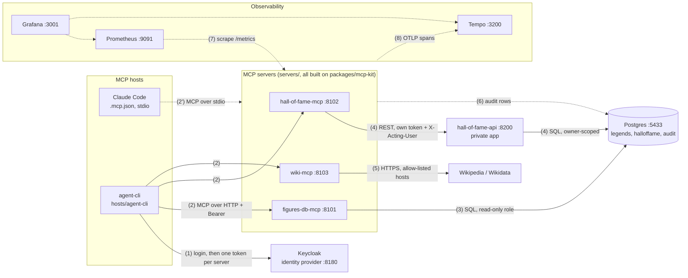

# MCP Tech Legends

A teaching repo for building **MCP servers, MCP clients and MCP hosts** the way a production
team would: three servers behind one shared kit, two hosts, OAuth per server, audit, metrics
and one trace across everything.

**The exercise.** An assistant answers questions about technology pioneers (Steve Jobs, Ada
Lovelace, Linus Torvalds, ...) and lets each user keep a private *Hall of Fame* with notes:

> *Compare Steve Jobs and Bill Gates' first products, check Wikipedia for anything my database
> is missing, and save a short note about Bill Gates to my Hall of Fame.*

Answering that needs three different kinds of system, so there are three MCP servers:

| MCP server | Wraps | The lesson it teaches |
|---|---|---|
| `figures-db-mcp` | a Postgres database (read-only) | typed query tools instead of raw SQL, least-privilege DB role |
| `hall-of-fame-mcp` | a private REST app, `hall-of-fame-api` | wrapping an internal API, writes, idempotency, no token passthrough |
| `wiki-mcp` | public Wikipedia + Wikidata APIs | outbound safety (allow-list, timeouts, cache), untrusted web text |

MCP spec 2026-07-28, Python SDK `mcp` 2.3.0, Claude via `anthropic` 2.3. Data is demo data.

## Architecture



1. agent-cli logs the user in at Keycloak once, then mints a separate token for each server.
2. It talks MCP (JSON-RPC) to each server over HTTP. (2') Claude Code starts the same servers over stdio.
3. figures-db-mcp reads Postgres as a role that can only `SELECT`.
4. hall-of-fame-mcp calls the private API with its **own** token, naming the user in a header; the API only returns that user's rows.
5. wiki-mcp calls Wikipedia/Wikidata through an allow-list, with timeouts, size caps and a cache.
6. Every call, allowed or denied, writes one audit row through an INSERT-only role.
7. Prometheus scrapes call counts, latency and denials from each server.
8. Every process exports trace spans; one question becomes one trace across the host and all servers.

## The mental model

| Idea | Why | Where |
|---|---|---|
| **The model is untrusted** | it picks the tool calls and reads text that can steer it, so checks live in servers | `packages/mcp-kit/src/mcp_kit/policy.py` |
| **Write cross-cutting rules once** | auth, policy, audit, logs, metrics, traces are identical for every server | `packages/mcp-kit/` |
| **Same shape for every server** | `config -> models -> backend -> tools -> server -> __main__`; learn one, read all | `servers/*/src/*/` |
| **Thin MCP layer** | `backend.py` has no MCP imports; `tools.py` only validates, describes and delegates | each server |
| **One audience per server** | a token for one server is useless at another | `infra/keycloak/realm.json`, `hosts/agent-cli/src/agent_cli/auth.py` |
| **Scope AND role** | scope = what the app may ask; role = what the user may do | `require()` in `policy.py` |
| **Writes are idempotent** | models and networks retry | `idempotency_key` tools, `Idempotency-Key` header |
| **Errors are results** | the model reads "permission denied" and adapts; internals stay hidden | `run_with_policy` |

## Read it in the order we built it

Each step matches one commit (`git log --reverse`). Open the files in the order listed.

**Step 0. The idea.** [`README.md`](README.md) (this page) -> [`docs/01-mcp-concepts.md`](docs/01-mcp-concepts.md).
Host, client, server; tools vs resources vs prompts; stdio vs HTTP.

**Step 1. The layout.** [`pyproject.toml`](pyproject.toml) (uv workspace: one package per folder)
-> [`Makefile`](Makefile) (every command you need) -> [`infra/docker-compose.yml`](infra/docker-compose.yml).
*Try it:* `make help`

**Step 2. Data first.** [`infra/postgres/01_schema.sql`](infra/postgres/01_schema.sql) (three schemas, three owners)
-> [`02_roles.sql`](infra/postgres/02_roles.sql) (one least-privilege role per consumer)
-> [`generate_seed.py`](infra/postgres/generate_seed.py) (reproducible demo data).
*Try it:* `make env up`, then `make seed` to regenerate.

**Step 3. The shared kit.** In `packages/mcp-kit/src/mcp_kit/`: [`settings.py`](packages/mcp-kit/src/mcp_kit/settings.py)
-> [`observability.py`](packages/mcp-kit/src/mcp_kit/observability.py) -> [`audit.py`](packages/mcp-kit/src/mcp_kit/audit.py)
-> [`policy.py`](packages/mcp-kit/src/mcp_kit/policy.py) (the most important file) -> [`auth.py`](packages/mcp-kit/src/mcp_kit/auth.py)
-> [`server.py`](packages/mcp-kit/src/mcp_kit/server.py) -> [`tests/`](packages/mcp-kit/tests).
*Try it:* `uv run pytest packages`

**Step 4. The first server.** In `servers/figures-db-mcp/src/figures_db_mcp/`: [`config.py`](servers/figures-db-mcp/src/figures_db_mcp/config.py)
-> [`models.py`](servers/figures-db-mcp/src/figures_db_mcp/models.py) -> [`backend.py`](servers/figures-db-mcp/src/figures_db_mcp/backend.py)
-> [`tools.py`](servers/figures-db-mcp/src/figures_db_mcp/tools.py) -> [`server.py`](servers/figures-db-mcp/src/figures_db_mcp/server.py)
-> [`__main__.py`](servers/figures-db-mcp/src/figures_db_mcp/__main__.py) -> [`tests/`](servers/figures-db-mcp/tests).
Then [`docs/02-anatomy-of-a-server.md`](docs/02-anatomy-of-a-server.md).
*Try it:* `uv run pytest servers/figures-db-mcp`

**Step 5. Plug it into a host you already have.** [`.mcp.json`](.mcp.json): how Claude Code starts each server over stdio.
*Try it:* `set -a; source .env; set +a; claude`, approve the servers, ask "Who founded NVIDIA?"

**Step 6. A server that calls the internet.** `servers/wiki-mcp/src/wiki_mcp/`, same order as step 4.
Focus on `_get_json` in [`backend.py`](servers/wiki-mcp/src/wiki_mcp/backend.py) and the `trust` field in [`models.py`](servers/wiki-mcp/src/wiki_mcp/models.py).
*Try it:* `uv run pytest servers/wiki-mcp`

**Step 7. A server that wraps a private API.** First the API, `apps/hall-of-fame-api/src/hall_of_fame_api/`:
[`auth.py`](apps/hall-of-fame-api/src/hall_of_fame_api/auth.py) -> [`store.py`](apps/hall-of-fame-api/src/hall_of_fame_api/store.py)
-> [`app.py`](apps/hall-of-fame-api/src/hall_of_fame_api/app.py). Then the server, `servers/hall-of-fame-mcp/src/hall_of_fame_mcp/`,
same order as step 4: focus on `_service_token` in [`backend.py`](servers/hall-of-fame-mcp/src/hall_of_fame_mcp/backend.py) and `required_role` in [`tools.py`](servers/hall-of-fame-mcp/src/hall_of_fame_mcp/tools.py).
*Try it:* `uv run pytest apps servers/hall-of-fame-mcp`

**Step 8. Your own host.** In `hosts/agent-cli/src/agent_cli/`: [`connections.py`](hosts/agent-cli/src/agent_cli/connections.py)
-> [`loop.py`](hosts/agent-cli/src/agent_cli/loop.py) -> [`__main__.py`](hosts/agent-cli/src/agent_cli/__main__.py) -> [`tests/test_loop.py`](hosts/agent-cli/tests/test_loop.py).
Then [`docs/03-building-a-host.md`](docs/03-building-a-host.md).
*Try it:* `make chat` (needs `ANTHROPIC_API_KEY`)

**Step 9. Security across the whole system.** [`infra/keycloak/realm.json`](infra/keycloak/realm.json) (client scopes -> audiences, users, roles)
-> [`hosts/agent-cli/src/agent_cli/auth.py`](hosts/agent-cli/src/agent_cli/auth.py) (one token per server)
-> [`hosts/agent-cli/tests/test_e2e_http.py`](hosts/agent-cli/tests/test_e2e_http.py) (the security claims, tested)
-> [`docs/04-security.md`](docs/04-security.md).
*Try it:* `make up test-integration`

**Step 10. Seeing it run.** [`infra/prometheus/`](infra/prometheus) -> [`infra/tempo/tempo.yml`](infra/tempo/tempo.yml)
-> [`infra/grafana/`](infra/grafana) -> [`docs/05-observability.md`](docs/05-observability.md).
*Try it:* `make demo`, then open Grafana and find the trace.

**Step 11. Build your own.** The checklist at the end of [`docs/02-anatomy-of-a-server.md`](docs/02-anatomy-of-a-server.md): add a fourth server.

## Run it

Prerequisites: Docker Desktop, [uv](https://docs.astral.sh/uv/) 0.13+, and for the hosts an
`ANTHROPIC_API_KEY` (agent-cli) or Claude Code.

```bash
make env                    # .env with random local passwords (once)
make up                     # 9 containers; first run builds the image
make test                   # unit tests, no Docker needed
make test-integration       # everything, against the running stack
make demo                   # the example question, over HTTP, as user ada
uv run agent-cli --transport http --user linus   # viewer: reads work, saving is denied
```

| URL | What |
|---|---|
| http://localhost:8101/mcp, :8102/mcp, :8103/mcp | the three MCP servers (need a token) |
| http://localhost:8180 | Keycloak admin (`admin` / `KEYCLOAK_ADMIN_PASSWORD`); users `ada`, `linus` |
| http://localhost:3001 | Grafana (`admin` / `GRAFANA_ADMIN_PASSWORD`), dashboard "MCP servers" |
| http://localhost:9091 | Prometheus (targets, alerts) |

All ports bind to `127.0.0.1`. The `dev-only-*` secrets and passwords in `infra/keycloak/realm.json`
are local fixtures; see the last section of [`docs/04-security.md`](docs/04-security.md).

## Tools at a glance

| Server | Tools | Scope (role) |
|---|---|---|
| figures-db-mcp | `search_figures`, `get_figure`, `list_products`, `get_timeline`, `compare_figures` | `figures:read` |
| wiki-mcp | `search_wikipedia`, `get_wikipedia_summary`, `get_wikidata_facts` | `wiki:read` |
| hall-of-fame-mcp | `list_collections`, `get_collection`, `list_notes` | `halloffame:read` |
| hall-of-fame-mcp | `create_collection`, `add_figure_to_collection`, `add_note` | `halloffame:write` (`legends-curator`) |

Resources: `legends://figures/{slug}`, `legends://organizations`, `halloffame://collections/{collection_id}`.
Prompts: `profile_figure`, `fact_check_figure`, `curate_collection`.

## Repository map

```
packages/mcp-kit/     shared rules for every server: settings, auth, policy, audit, observability, serve()
servers/              figures-db-mcp, hall-of-fame-mcp, wiki-mcp (same six-file shape)
apps/                 hall-of-fame-api: the private app (not an MCP server)
hosts/                agent-cli: the custom MCP host
infra/                docker-compose, postgres, keycloak, prometheus, grafana, tempo
docs/                 five short pages, read alongside the steps above
.mcp.json             how Claude Code (and agent-cli in stdio mode) start the servers
```
