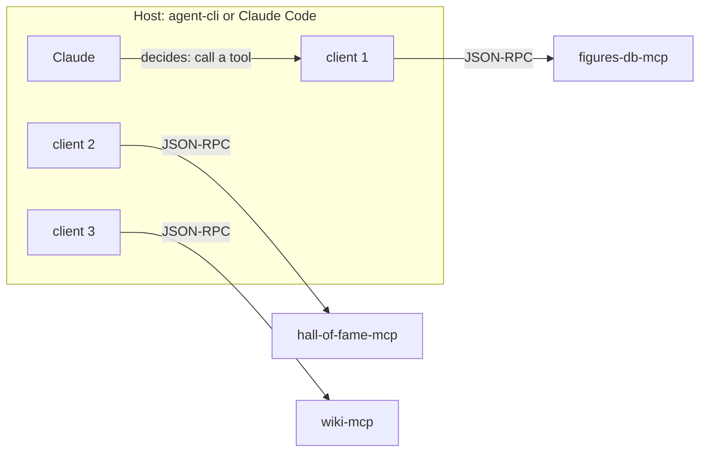

# 1. MCP concepts

## What MCP is

**MCP (Model Context Protocol)** is an open standard that lets an AI application discover and
use outside capabilities (data to read, actions to take) in one uniform way. You wrap a system
once as an MCP server; every MCP-aware app can then use it.

Analogy: USB for AI apps. Any USB device works with any computer because both follow one plug
standard. Where it stops being true: a USB device does what the computer tells it; an MCP tool
is chosen by a **language model**, which can be steered by text it reads. That is why every
check in this repo lives in the server.

## Three roles



| Role | Job | Here |
|---|---|---|
| **Host** | The app the user talks to. Runs the model, connects to servers, executes tool calls | `hosts/agent-cli/`, Claude Code |
| **Client** | One connection from the host to one server | `mcp.Client` in `hosts/agent-cli/src/agent_cli/connections.py` |
| **Server** | Exposes tools/resources/prompts, enforces rules, talks to the real system | `servers/*` |

Connections are **many-to-many**: one host uses N servers (one client each), and one server
can be shared by N hosts. Claude Code and agent-cli use the same three servers.

Misconception: "the model connects to the server". It does not. The model only outputs a
structured request; the host's client does the I/O; the server does the enforcement.

## Server features: tools, resources, prompts

| Feature | Who chooses it | For | Example |
|---|---|---|---|
| **Tool** | the model | an action or a live query | `compare_figures`, `add_note` |
| **Resource** | the app or user | read-only data by URI | `legends://figures/steve-jobs` |
| **Prompt** | the user | a reusable workflow template | `curate_collection` |

## The wire format: JSON-RPC 2.0

```json
{"jsonrpc": "2.0", "id": 7, "method": "tools/call",
 "params": {"name": "get_figure", "arguments": {"slug": "grace-hopper"}}}
```

The answer carries `structuredContent` (JSON matching the tool's output schema), a text copy in
`content`, and `isError`. Two kinds of failure:

| Kind | Example | Who sees it |
|---|---|---|
| Protocol error | unknown method, bad JSON | the client library |
| Tool error | "Permission denied", "No figure found" | **the model**, as a normal result with `isError: true` |

Tool errors are results on purpose: the model reads them and recovers ("use search_figures
first"). Unknown exceptions are hidden behind a reference id (`mcp_kit/policy.py`).

## Transports

| Transport | How | Used here by |
|---|---|---|
| **stdio** | the host starts the server as a child process; messages over stdin/stdout | Claude Code (`.mcp.json`), `make chat` |
| **Streamable HTTP** | the host POSTs JSON-RPC to `/mcp` | agent-cli `--transport http`, the docker stack |

Pitfall: in stdio mode anything printed to stdout corrupts the protocol. All logs go to stderr.

Since spec 2026-07-28 there is no `initialize` handshake and no session id: every request
carries its protocol version in `_meta`. Servers are **stateless**, so any replica can answer
any request (`stateless_http=True` in `mcp_kit/server.py`).

