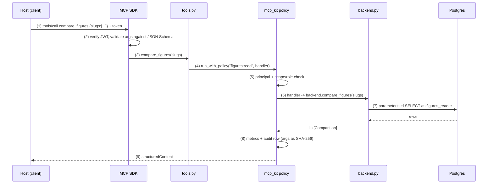

# 2. Anatomy of a server

Previous: [1. MCP concepts](01-mcp-concepts.md). Next: [3. Building a host](03-building-a-host.md).

Every server in `servers/` has the same six files. Learn one, and you can read all three.

## The six files

| File | Owns | Knows about MCP? |
|---|---|---|
| `config.py` | settings from `<PREFIX>_*` env vars (port, audience, backend URL) | no |
| `models.py` | Pydantic outputs; they become the tool's output schema | no |
| `backend.py` | the real work: SQL, REST client, web client. Raises `LookupError` etc. | **no** |
| `tools.py` | the tools: typed params, model-facing docstrings, one `run_with_policy` call each | yes |
| `server.py` | `INFO` (name, instructions) and `register()`: tools + resources + prompts | yes |
| `__main__.py` | builds settings and backend, calls `mcp_kit.server.serve()` | via the kit |

Why `backend.py` has no MCP imports: the business logic can be tested alone, reused behind a
REST API, or moved to another server without touching the protocol layer.

## What `mcp_kit` does for every server

```
 serve(INFO, settings, backend, register)          packages/mcp-kit/src/mcp_kit/server.py
   ├── configure_logging / configure_tracing       observability.py
   ├── stdio?  set_stdio_principal(scopes, roles)  policy.py   (no token on stdio)
   │   http?   JwtTokenVerifier(audience=...)      auth.py     (401 before any tool runs)
   ├── lifespan: backend.start() / backend.stop()
   ├── register(server, backend, policy)           the server's own tools/resources/prompts
   └── /healthz  /readyz (backend.ready())  /metrics
```

## One tool call, end to end: `compare_figures`



1. The host sends JSON-RPC with its bearer token (HTTP) or nothing (stdio).
2. Bad token: HTTP 401. Bad arguments (`slugs` with 5 items, a slug with spaces): rejected by
   the schema built from `Annotated[..., Field(...)]`. Your code never runs.
3. The SDK calls the decorated function in `tools.py`.
4. The tool does nothing but hand its work to `run_with_policy` with the scope it needs.
5. Missing scope or role: `PermissionDenied`, which the model reads as a tool error.
6. The handler calls the backend. `LookupError` becomes "No figure found... use search_figures".
7. SQL is parameterised (`$1`) and bounded (`LIMIT`); the role can only read.
8. The `finally` block always records metrics and one audit record, on every outcome.
9. The SDK serialises the Pydantic result as `structuredContent` plus text.

## The three servers compared

| | figures-db-mcp | hall-of-fame-mcp | wiki-mcp |
|---|---|---|---|
| Wraps | Postgres (`legends`) | private REST API | Wikipedia + Wikidata |
| Writes? | no | yes (idempotent) | no |
| Downstream auth | read-only DB role | own client-credentials token + `X-Acting-User` | none (public), allow-listed hosts |
| Main lesson | typed queries, not raw SQL | no token passthrough, scope + role | outbound safety, untrusted text |

## Add a fourth server (checklist)

1. Copy `servers/wiki-mcp` to `servers/<name>-mcp`, rename the package and the env prefix.
2. Write `backend.py` first, with tests and no MCP imports.
3. Add tools: one scope each, `verb_noun` names, docstrings that say when to use it and what it returns.
4. Add a client scope with an audience mapper in `infra/keycloak/realm.json`.
5. Add the service to `infra/docker-compose.yml` and `infra/prometheus/prometheus.yml`,
   and an entry to `.mcp.json`.
6. Add it to `server_scopes` / `http_servers` in `hosts/agent-cli/src/agent_cli/config.py`.
