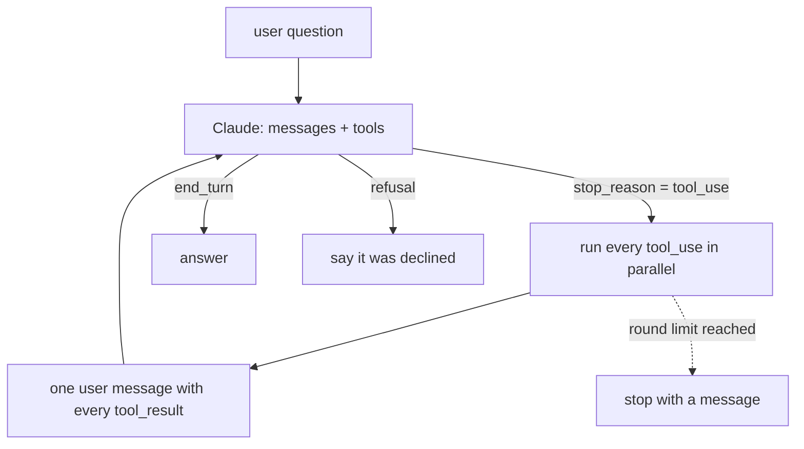

# 3. Building a host

Previous: [2. Anatomy of a server](02-anatomy-of-a-server.md). Next: [4. Security](04-security.md).

A host is the part most tutorials skip. `hosts/agent-cli` is about 450 lines including comments; this page walks it.

## What a host does

```
 (1) connect        one MCP client per server            connections.py  connect_all()
 (2) discover       tools/list on each server
 (3) namespace      "wiki" + "__" + "get_wikipedia_summary"
 (4) ask the model  question + every tool's JSON Schema  loop.py  run_turn()
 (5) execute        route each tool_use to its server, in parallel
 (6) report back    ALL tool_results in ONE user message, then ask again
 (7) answer         when the model stops asking for tools
```

## (1)-(3) Connections and the tool registry

`connections.py` builds one `mcp.Client` per server and keeps a route from each prefixed name
to `(client, original tool name)`.

- **stdio**: `stdio_servers(".mcp.json")` reads the *same file Claude Code reads*, so both hosts
  start the servers the same way.
- **HTTP**: `http_client(url, auth)` gives each client its own `httpx2.Auth` that attaches that
  server's token (see [4. Security](04-security.md)).

Why the prefix: two servers may both expose `search`. Claude Code does the same thing with
names like `mcp__wiki__search_wikipedia`.

## (4)-(7) The loop



Rules the loop follows (`loop.py`):

| Rule | Why |
|---|---|
| Return **all** tool results in **one** user message | splitting them teaches the model to stop calling tools in parallel |
| Send failed tools back with `is_error: true` | the model reads "Permission denied" and adapts; dropping it confuses the model |
| Append the full `response.content`, not just the text | the API needs the tool_use blocks to match the results |
| Check `stop_reason` before reading content | `refusal` means no content to act on |
| Cap the rounds (`max_tool_rounds`) | a confused model must not loop forever on your bill |

Model settings: `claude-opus-5-5`, `output_config.effort = "medium"`, server-side refusal
fallbacks on (`fallbacks="default"`). Change them with `AGENT_CLI_MODEL` and `AGENT_CLI_EFFORT`.

The loop is written by hand on purpose. In production you might use the SDK's tool runner;
it does the same steps for you, which is exactly why it is worth seeing them once.

## Testing a host without paying for a model

`hosts/agent-cli/tests/test_loop.py` uses a `ScriptedLlm` that plays back fake model responses
and records what the host sent, against real in-process MCP servers. It checks routing,
parallel results in one message, error results, refusal and the round limit.

## Two hosts, same servers

| | Claude Code | agent-cli |
|---|---|---|
| Config | `.mcp.json` (approve once) | `.mcp.json` (stdio) or `config.py` (HTTP) |
| Transport | stdio | stdio or HTTP |
| Identity | `<PREFIX>_STDIO_*` settings in `.mcp.json` | real Keycloak login, token per server |
| Loop | Claude Code's | `loop.py` |

Try it: `claude` in the repo (approve the three servers), then ask "Compare Steve Jobs and Bill
Gates". Or `make chat` (needs `ANTHROPIC_API_KEY`).
