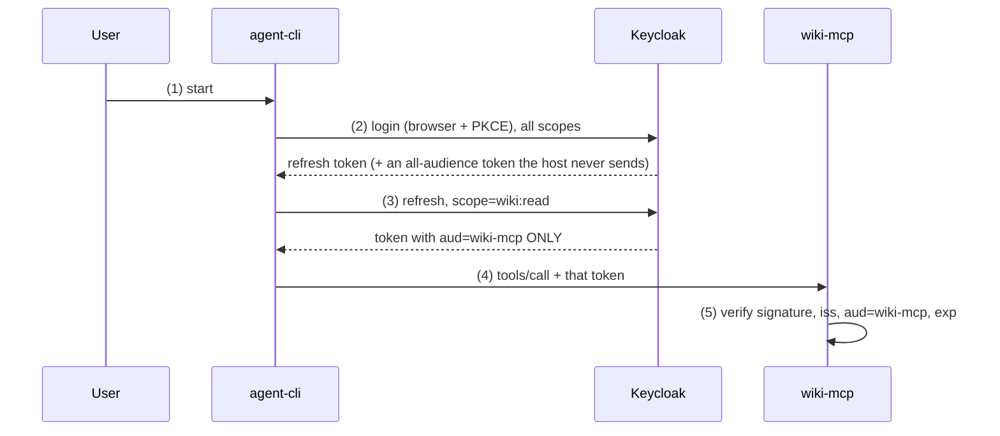

# 4. Security

Previous: [3. Building a host](03-building-a-host.md). Next: [5. Observability](05-observability.md).

The model is untrusted: it chooses tool calls and reads text (web pages, notes) that can steer
it. So every rule below is enforced by a server or the identity provider, never by the model.

## Identity: one login, one token per server

- Each MCP server is an OAuth 2.1 **resource server** with its own **audience**. Keycloak's
  client scopes map `figures:read` -> `figures-db-mcp`, `wiki:read` -> `wiki-mcp`,
  `halloffame:*` -> `hall-of-fame-mcp` (`infra/keycloak/realm.json`).
- The host mints a narrow token per server (`hosts/agent-cli/src/agent_cli/auth.py`). A token
  leaked from one server is rejected by the others (tested in `test_e2e_http.py`).

## Authorisation: scope AND role

| Check | Answers | Comes from | Example |
|---|---|---|---|
| **scope** | what the *app* may ask for | the OAuth client's allowed scopes | `halloffame:write` |
| **role** | what the *user* may do | Keycloak realm roles in the token | `legends-curator` |

`linus` (viewer) logs in through the same app, so his token *has* `halloffame:write`, but not
the curator role: `add_note` is denied before the API is called. Both checks run in
`run_with_policy` (`packages/mcp-kit/src/mcp_kit/policy.py`).

## Downstream: no token passthrough

`hall-of-fame-mcp` never forwards the user's token to the private API (the MCP spec forbids it:
that token's audience is the MCP server). Instead it:

1. gets **its own** token by client credentials (`aud=hall-of-fame-api`), cached until expiry;
2. sends the verified user in `X-Acting-User`;
3. the API trusts that header **only** from the `hall-of-fame-mcp` client
   (`apps/hall-of-fame-api/src/hall_of_fame_api/auth.py`).

Next step in production: OAuth token exchange (RFC 8693), which puts the user inside the token.

## Defence in depth

| Layer | Stops | Where |
|---|---|---|
| Token verification | anonymous, forged, expired, wrong-audience tokens | `mcp_kit/auth.py` (RS256/ES256 only) |
| Scope + role | a valid caller acting outside its role | `mcp_kit/policy.py` |
| Input schema | malformed or oversized arguments | `Annotated[..., Field(...)]` in each `tools.py` |
| Least-privilege DB roles | a bug doing more than the tool needs | `infra/postgres/02_roles.sql` |
| Per-user data scoping | reading another user's data (IDOR) | every query in `hall_of_fame_api/store.py` has `owner = $n` |
| Idempotency keys | a retry creating a duplicate | `Idempotency-Key` + unique column |
| Outbound allow-list | SSRF via the web server | `wiki_mcp/backend.py` `_get_json` |
| Append-only audit | actions without a trace | `audit.events`, INSERT-only role |

## MCP-specific threats

| Threat | Control here |
|---|---|
| Prompt injection from web text | results marked `trust: untrusted-web-content`; server and host instructions say "data, not instructions"; writes need a role |
| Confused deputy | per-server audience check |
| Token passthrough | service credential + `X-Acting-User` |
| Over-permission | one scope per tool, roles for writes, read-only DB role |
| Leaking internals | unknown errors become a reference id; tokens never logged |

## Local-only shortcuts (change before any real use)

- `dev-only-*` client secrets and user passwords in `realm.json`; `agent-cli-test` password grant.
- Keycloak in `start-dev` mode over HTTP; servers over HTTP (put TLS in front in production).
- `/metrics` served without auth; keep it on an internal network.
