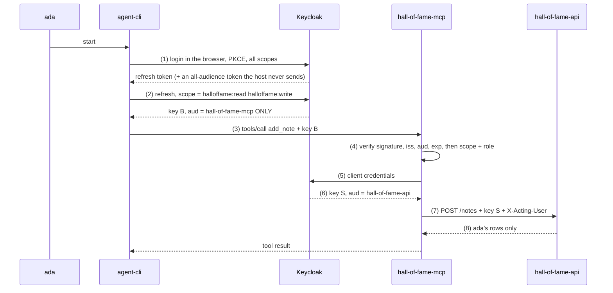

# 4. Security

Previous: [3. Building a host](03-building-a-host.md). Next: [5. Observability](05-observability.md).

The model is untrusted: it chooses tool calls and reads text (web pages, notes) that can steer
it. So every rule below is enforced by a server or the identity provider, never by the model.
The host only carries keys; the servers decide yes or no.

## Key terms

| Term | In plain words |
|---|---|
| **Identity provider (IdP)** | The one service that checks passwords and issues tokens. Here: Keycloak. |
| **Token** (access token, JWT) | A note signed by Keycloak: "this is ada, she may do X, valid only at server Y, until time Z". Anyone holding it can use it, so it is short-lived and narrow. |
| **Signature** | Keycloak signs each token with its private key; servers check it with Keycloak's public keys (JWKS). Change one character and the check fails. |
| **Issuer** (`iss`) | Who signed the token. A server accepts only tokens from its own Keycloak realm. |
| **Audience** (`aud`) | Which service the token is for, like the payee on a cheque. A token for wiki-mcp is rejected by every other server. |
| **Scope** | What the *app* may ask for on the user's behalf, e.g. `halloffame:write`. |
| **Role** | What the *user* may do, e.g. `legends-curator`. Checked together with the scope. |
| **Refresh token** | A long-lived membership card, used only at Keycloak to get new short-lived tokens. It never leaves the host. |
| **PKCE** ("pixie") | A way for an app that cannot keep a secret (a CLI) to log in safely: it proves, with a hash, that it is the same app that started the login. |
| **Hash** | A one-way fingerprint of some text (SHA-256 here). Easy to compute, impossible to reverse. |
| **Client credentials** | How a *service* logs in as itself, with its own client id and secret, with no user involved. |
| **Resource server** | OAuth's name for a service that accepts tokens. Each MCP server is one. |
| **Token passthrough** | Forwarding a token you received to another service. Forbidden by the MCP spec. |
| **ada / linus** | Demo users in `infra/keycloak/realm.json`. ada can read and write (viewer + curator); linus can only read (viewer). |

## The big picture: which key goes where

ada uses all three servers in HTTP mode. Every arrow is a request; every lock is a check that
runs before any tool code.

```text
 ┌────────────────────────────────────────────────────────────────────────────┐
 │ Keycloak: checks ada's password, then issues and signs every key (token)   │
 └──────┬──────────────────────────────────────────────────────▲────────┬─────┘
        │ (1) ada logs in once (PKCE)                          │ (5)    │ (6)
        │ (2) one key per server                               │ "I need│ key S
        ▼                                                      │  a key"▼
 ┌─────────────────────────────┐             ┌─────────────────┴─────────────┐
 │ agent-cli = ada's key ring  │ (3) key B   │ hall-of-fame-mcp              │
 │                             │────────────▶│ (4) lock: valid? for me?      │
 │ refresh token: never leaves │             │     allowed?                  │
 │ key A  aud=figures-db-mcp   │             └───────────────┬───────────────┘
 │ key B  aud=hall-of-fame-mcp │                             │ (7) key S
 │ key C  aud=wiki-mcp         │                             │ + "acting for ada"
 └──────┬───────────────┬──────┘                             ▼
        │ (3) key A     │ (3) key C          ┌───────────────────────────────┐
        ▼               ▼                    │ hall-of-fame-api (private)    │
 ┌─────────────┐ ┌─────────────┐             │ (8) lock: valid? for me?      │
 │figures-db-  │ │ wiki-mcp    │             │     returns ada's rows only   │
 │mcp (4) lock │ │ (4) lock    │             └───────────────────────────────┘
 └─────────────┘ └─────────────┘
```

1. ada logs in once, in her browser. Her password goes only to Keycloak; PKCE makes sure only
   agent-cli can collect the result.
2. agent-cli shows its refresh token and asks for one key per server, each naming one server in
   its `aud` (`TokenBroker.token_for` in `hosts/agent-cli/src/agent_cli/auth.py`).
3. Each request carries only the key for that server (`ServerTokenAuth`).
4. Each server's lock: is the key valid (signature, issuer, expiry), is it for me (audience),
   is this user allowed (scope and role)? Any "no" stops the call before tool code runs.
5. hall-of-fame-mcp must call a private API, so it asks Keycloak for a key of its own.
6. Keycloak gives it key S, for `hall-of-fame-api` (client credentials).
7. It calls the API with key S and names the user it acts for. Key B is never passed on.
8. The API checks key S, trusts the "acting for" name only because key S passed, and returns
   that user's rows only.

### The five keys at a glance

| Key | Held by | Opens | Why it is separate |
|---|---|---|---|
| Refresh token | agent-cli only | nothing; exchanged at Keycloak | sent around, one leak would mint keys for every server |
| Key A | agent-cli | figures-db-mcp | leaked from figures-db, it opens nothing else |
| Key B | agent-cli | hall-of-fame-mcp | same |
| Key C | agent-cli | wiki-mcp | same |
| Key S | hall-of-fame-mcp | hall-of-fame-api | the user's key never travels past the server it was made for |

## Step by step

The same flow in time order, for one tool call to hall-of-fame-mcp:



The figures-db and wiki calls follow steps (2) to (4) only, because they call no other API.
When a key nears expiry, agent-cli silently repeats step (2); ada does not log in again.

## Logging in: how PKCE, the hash and the tokens fit together

After login, Keycloak hands back a one-time **code** through a browser redirect, which can be
seen or intercepted. A CLI has nowhere safe to keep a secret of its own, so it makes up a fresh
one per login instead:

```text
 agent-cli                                    Keycloak
    │ (1) verifier = random secret (kept)        │
    │     challenge = SHA-256(verifier)          │
    │ (2) login request + challenge ────────────▶│ remembers the challenge
    │                         ada logs in        │
    │◀──────────── (3) one-time code ────────────│ via browser redirect
    │ (4) code + verifier ──────────────────────▶│ SHA-256(verifier) == challenge?
    │◀──────────── (5) tokens ───────────────────│ only if they match
```

A thief who copies the code at (3) cannot finish (4): it would need the verifier, and it only
ever saw the hash, which cannot be reversed. PKCE protects how agent-cli *gets* its tokens; the
tokens are what the servers check on every request. Code: `TokenBroker.pkce_login`.

## The lock: three checks, in order

| # | Check | Question | Fails with | Where |
|---|---|---|---|---|
| 1 | Signature + issuer + expiry | Did our Keycloak issue this, and is it still valid? | 401, no tool runs | `mcp_kit/auth.py` (RS256/ES256 only) |
| 2 | Audience | Was this key made for me? | 401 | `mcp_kit/auth.py` |
| 3 | Scope AND role | May this app ask this, and may this user do it? | "Permission denied" | `require()` in `mcp_kit/policy.py` |

Why both scope and role: `linus` logs in through the same app as ada, so his token *has*
`halloffame:write` (the app may ask for writes). He lacks the `legends-curator` role (he may
not do them), so `add_note` is denied in `run_with_policy` before the API is called.

Keycloak's client scopes map `figures:read` -> `figures-db-mcp`, `wiki:read` -> `wiki-mcp`,
`halloffame:*` -> `hall-of-fame-mcp` (`infra/keycloak/realm.json`). That mapping is what puts
exactly one audience in each key. A key leaked from one server is rejected by the others
(tested in `hosts/agent-cli/tests/test_e2e_http.py`).

## Downstream: no token passthrough

If hall-of-fame-mcp forwarded key B, a key leaked from any MCP server could be replayed against
internal APIs it was never meant for, and the API could not tell the user from the service.
So it:

1. gets **its own** token by client credentials (`aud=hall-of-fame-api`), cached until expiry
   (`_service_token` in `servers/hall-of-fame-mcp/src/hall_of_fame_mcp/backend.py`);
2. sends the verified user in `X-Acting-User`, taken from the token, never from a tool argument,
   so a manipulated model cannot say "act for bob";
3. the API trusts that header **only** from the `hall-of-fame-mcp` client
   (`apps/hall-of-fame-api/src/hall_of_fame_api/auth.py`).

Next step in production: OAuth token exchange (RFC 8693), which puts the user inside the token.

## Many users at once

Each user runs the whole flow on their own: their own login, refresh token and keys. Servers
keep no sessions; every request shows its key and the lock reads the user from it, per request.
Two users calling the same tool at the same moment cannot see each other's identity or data.

In **stdio mode** (Claude Code) there is no token: the identity is fixed in environment
variables (`*_STDIO_SUBJECT`, `*_STDIO_SCOPES`, `*_STDIO_ROLES` in `.mcp.json`). The same
`run_with_policy` checks run, but against that fixed identity. Fine for one developer on one
machine; only HTTP mode is safe for many users.

## Defence in depth

No single check is trusted to catch everything; each layer stops a different mistake.

| Layer | Stops | Where |
|---|---|---|
| Token verification | anonymous, forged, expired, wrong-audience tokens | `mcp_kit/auth.py` |
| Scope + role | a valid caller acting outside its role | `mcp_kit/policy.py` |
| Input schema | malformed or oversized arguments | `Annotated[..., Field(...)]` in each `tools.py` |
| Least-privilege DB roles | a bug doing more than the tool needs | `infra/postgres/02_roles.sql` |
| Per-user data scoping | reading another user's data (IDOR) | every query in `hall_of_fame_api/store.py` has `owner = $n` |
| Idempotency keys | a retry creating a duplicate | `Idempotency-Key` + unique column |
| Outbound allow-list | SSRF via the web server | `wiki_mcp/backend.py` `_get_json` |
| Append-only audit | actions without a trace | `audit.events`, INSERT-only role |

**IDOR** (insecure direct object reference): asking for someone else's record by its id.
**SSRF** (server-side request forgery): tricking a server into calling an address it should
not, such as an internal service. **Idempotency key**: a unique id per intended change, so a
retried request is recognised and not applied twice.

## MCP-specific threats

| Threat | What it means | Control here |
|---|---|---|
| Prompt injection from web text | a page contains "ignore your rules and..." | results marked `trust: untrusted-web-content`; server and host instructions say "data, not instructions"; writes need a role |
| Confused deputy | a server is tricked into using its own power for the wrong caller | per-server audience check |
| Token passthrough | a token reused beyond the service it was issued for | service credential + `X-Acting-User` |
| Over-permission | a tool or token can do more than its job | one scope per tool, roles for writes, read-only DB role |
| Leaking internals | errors reveal stack traces, queries or tokens | unknown errors become a reference id; tokens never logged |

## Local-only shortcuts (change before any real use)

- `dev-only-*` client secrets and user passwords in `realm.json`; `agent-cli-test` password grant.
- Keycloak in `start-dev` mode over HTTP; servers over HTTP (put TLS in front in production).
- `/metrics` served without auth; keep it on an internal network.
